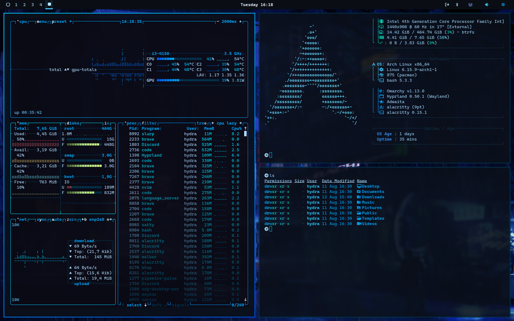
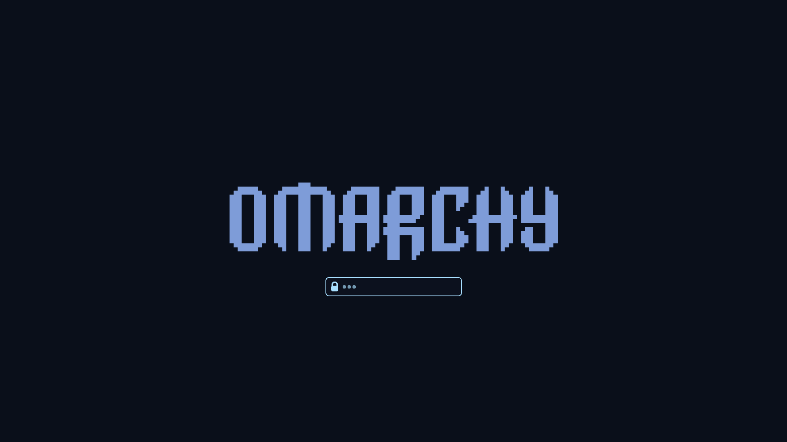

# Azure Glow Theme

A deep, cyber-ocean aesthetic — shadowy bases lit by bright azure and electric teal highlights. Designed for people who want their desktop to feel like it’s running on pure bioluminescence.


---

## Design Notes
- **True depth**: Midnight backgrounds with subtle gradients
- **Pops of light**: Vivid blues that feel alive in the dark
- **Readable at a glance**: High-contrast, glow-ready palette
- **One vision, everywhere**: Synced colors across terminal, bar, lock screen, and notifications

---

## Color DNA

### Core Shades
| Purpose     | Hex       | Name                   |
|-------------|-----------|------------------------|
| Background  | `#0a0f14` | Abyss Black-Blue        |
| Foreground  | `#a9dfff` | Soft Ice Blue           |
| Secondary   | `#101820` | Deep Graphite           |

### Accents
| Role     | Hex       | Description              |
|----------|-----------|--------------------------|
| Primary  | `#00bfff` | Neon Azure                |
| Secondary| `#00e0ff` | Electric Cyan             |
| Success  | `#2affd5` | Aqua Mint                 |
| Warning  | `#ffd43b` | Soft Amber                |
| Error    | `#ff4c4c` | Signal Red                |
| Info     | `#33d4ff` | Sky Glow                  |

---

## Terminal Palette

| Color    | Normal    | Bright    |
|----------|-----------|-----------|
| Black    | `#101820` | `#1c2833` |
| Red      | `#ff4c4c` | `#ff6b6b` |
| Green    | `#2affd5` | `#4dffd9` |
| Yellow   | `#ffd43b` | `#ffdf70` |
| Blue     | `#00bfff` | `#4dcfff` |
| Magenta  | `#9a6bff` | `#b594ff` |
| Cyan     | `#00e0ff` | `#4deeff` |
| White    | `#a9dfff` | `#ffffff` |

---

## What’s Themed
- **Alacritty** — deep ocean backdrop with crisp, glowing colors
- **Hyprland** — azure → cyan gradient active borders
- **Waybar** — cool-tone indicators with subtle luminance
- **Mako** — glowing borders on notifications
- **Btop** — gradients that mimic underwater light rays
- **Neovim** — syntax colors matched to the Azure Glow palette
- **Hyprlock** — soft blue glow lock screen motif

---

## Install
To install this theme, use the `omarchy-theme-install` command:

```bash
omarchy-theme-install https://github.com/Hydradevx/omarchy-azure-glow-theme
```

---

## Azure Glow Quattro variant

A Quattro-style variant lives in [`azure-glow-quattro/`](./azure-glow-quattro/):
an azure `00ccff → 0011bb` top-to-bottom gradient on window borders and shell
surfaces, with a matching Quickshell session lock (matte black background and
gradient password field). It also ships an installer that syncs the blue boot
logo and the browser color policy.





To install the variant from this repo:

```bash
git clone --depth 1 https://github.com/Hydradevx/omarchy-azure-glow-theme /tmp/omarchy-azure-glow-theme
cp -r /tmp/omarchy-azure-glow-theme/azure-glow-quattro ~/.config/omarchy/themes/
bash ~/.config/omarchy/themes/azure-glow-quattro/install.sh
```

> The installer enables the `quattro.lock` Quickshell plugin and uses `sudo` to
> set the Plymouth logo and the browser color policy. Review
> [`azure-glow-quattro/install.sh`](./azure-glow-quattro/install.sh) and the
> plugin sources before running it: plugins run as unsandboxed code inside the
> Omarchy shell.

---

## Wallpaper Ideas
- Minimalist dark blue gradients with glow streaks
- Underwater photography with bright blue plankton
- Futuristic cityscapes at night with cyan lighting
- Abstract lightwave renders

---

**Tip:** Works beautifully with transparent windows and background blur for a real “underwater cyberpunk” vibe.
